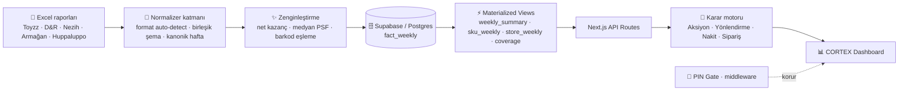

<div align="center">

# 🧠 CORTEX

### Mythos Retail Intelligence

**Beş perakendecinin dağınık Excel'lerini tek bir karar motoruna dönüştüren çok-perakendeci satış & stok zekâsı sistemi.**


</div>

---

## Neden var?

Beş perakende kanalının her biri raporunu **farklı Excel formatında, farklı günde, farklı marj ve ödeme vadesiyle** gönderiyor. Bunları elle birleştirmek yavaş, hataya açık ve karar üretmiyor. CORTEX bu akışı uçtan uca otomatikleştirir: her kanalın dosyasını tek bir birleşik şemaya indirir, haftaları ortak takvime hizalar, marj + KDV düşerek **net kazanca** çevirir ve sonucu — bir tablo değil — **"bu hafta ne yapmalı"** kararlarına dönüştürür.

> Cevapladığı sorular: **"Ne sattık, nerede kazandık, hangi ürün nerede tükeniyor, neyi geri çekmeli, para ne zaman kasaya girer?"**

Entegre kanallar: **Toyzz · D&R · Nezih · Armağan · Huppaluppo** — beşi de canlı. Ölçek: ~356K satır ham veri, 30+ haftalık Excel, materialized view'lerle ~1–2 sn sorgu.

---

## ✨ Özellikler

CORTEX üç katmanlı okunur: **DURUM** (ne oldu) → **KARAR** (ne yapmalı) → **DETAY** (neden).

| | |
|---|---|
| 📊 **Kontrol Paneli** | Ağ geneli net ciro, sell-through, aktif SKU. Tüm WoW deltaları **aynı-firma kohortuyla** (yalnız iki haftada da veri veren firmalar) — kısmi haftada "elmayla armut" karşılaştırması yapmaz; kısmi hafta rozetle işaretlenir. |
| ⚡ **Aksiyon Zekâsı** | Bu hafta ne **sevk** et (tükenme riski), ne **çek** (bağlı sermaye/PSF) — gerekçesiyle, tek panelde. |
| 🔀 **Yönlendirme** | **ABC-XYZ × sezon** karar motoru: transfer / depo / likidasyon; hangi kanaldan hangisine, paylaşımlı kapasite defteriyle. |
| 📦 **Sipariş Önceliği** | **EWMA** hız + kaç hafta yeter; tükenmeden uyarı, hızlanan/yavaşlayan ürün için ivme oku. |
| 💰 **Nakit Takvimi** | Kanal vadeleriyle (30/90/95/150g) *"para hangi ay kasaya girer"* projeksiyonu + sahada bekleyen alacak. |
| 🏬 **Mağaza Zekâsı** | Şube bazlı satış & stok; mağaza kırılımı gönderen kanallarda şehir/grup analizi ve ürün drill-down. |
| 🔗 **Ürün Eşleştirme** | Barkodsuz kalemleri EAN'e bağlar; aynı ürünü beş firmada tek kimlikte birleştirir (firmalar-arası kıyas). |
| 🩺 **Veri Sağlığı Bekçisi** | Her yüklemede eksik hafta, bayat firma, fiyatsız satır, negatif stok, mojibake denetimi + 0–100 skor. |
| 🏆 **Sıralamalar & Karşılaştır** | En çok satan / büyüme liderleri (firmalar-arası birleşik); dönem ve kanal kıyası. |
| 📈 **Trend & Isı Haritası** | Haftalık seyir (TL varsayılan) ve kanal × hafta yoğunluk görünümü. |
| 📥 **Self-servis Yükleme** | `/upload`'a Excel sürükle → format **otomatik tanınır**, hafta seçilir, **mutabakat** (önceki haftaya göre sapma) anında gösterilir. |
| 📋 **Haftalık Mail** | Seçili haftanın durum mailini (net tablo + kohort WoW + eksik firma notu) tek tıkla üretir. |

**Tasarım ilkesi:** Tüm para yüzeyleri **net kazanç** gösterir (raf fiyatı değil), tüm büyüme göstergeleri **varsayılan ciro (TL) bazlıdır** — "adet arttı ama ciro düştü" yanılgısını engeller.

---

## 🏗️ Mimari



**Akışın özü:** Ham Excel → normalize + zenginleştir → tek gerçek tablo (`fact_weekly`) → ağır toplamlar **materialized view**'larda önceden hesaplanır (free-tier sorgu zaman aşımını aşmamak için) → API → karar motoru → pano. Her veri yazımından sonra `refresh_summaries()` görünümleri tazeler (600s timeout ile RPC'den de çalışır).

---

## 🧩 Veri işleme (normalizer'lar)

Her kanalın formatı farklı; hepsi ortak bir `UnifiedRow` şemasına indirgenir:

- **Toyzz / D&R** — Asepto formatı (`asepto.ts`, 3 varyant). Ciro = PSF × adet. Etiketsiz "Genel Toplam" satırları elenir (çift sayımı önler).
- **D&R (yeni)** — "Satın Alma - Kategori" formatı (`dr-kategori.ts`); kolon parmak iziyle **otomatik tanınır** (eski mağaza-bazlı D&R formatını yanlışlıkla ele geçirmez). Fiyatsız → medyan PSF ile ciro tamamlanır.
- **Nezih** — barkod formatı (`nezih.ts`); kendi TL'si yok → barkod bazında diğer kanalların fiyatından **medyan birim fiyat** türetilerek ciro tamamlanır.
- **Armağan** — mağaza-bazlı (`armagan.ts`); Lokasyon/Barkod/Satış Fiyatı/Geçmiş Stok. Şehir önekli şube adları store analizine döner.
- **Huppaluppo** — "Stok Raporu" (`huppaluppo.ts`); başlık offsetli, hafta dosyanın içindeki tarih aralığından okunur, TL hazır gelir.

**Kanonik hafta:** Kanallar aynı haftayı farklı gün/etiketle gönderir → tüm `week_start` ISO Pazartesi'sine hizalanır. Tarihsiz/geç gelen dosyalarda hafta yükleme sırasında seçilebilir; Türkçe "HAZİRAN" gibi büyük-İ'li dosya adları özel fold ile doğru çözülür.

---

## ⚙️ Karar motoru — sadece toplama değil

| Kavram | Mantık |
|---|---|
| **Net kazanç** | `net = PSF × (1 − kanal_marjı%) ÷ 1,20` (KDV). Raf fiyatı değil, bize kalan. Marjlar %43–50; tek noktadan (`margins.ts`) güncellenir. |
| **ABC-XYZ segment** | Değer Pareto'su (A/B/C) × talep oynaklığı CV'si (X<0,5 / Y / Z>1) → segment başına kapsam hedefi matrisi (hafta). Yönlendirme kararının temeli. |
| **EWMA hız** | `vₜ = α·xₜ + (1−α)·vₜ₋₁`, α=0,4 — son haftalar baskın; ivmeyi düz ortalamadan önce yakalar. |
| **Kapsam / newsvendor** | `stok ÷ hız = kaç hafta yeter`; <1 hf acil, segment-servis-seviyesi kapsam hedefi. |
| **Kohort WoW** | Karşılaştırma yalnız iki haftada da veri veren firmalarla — kısmi hafta toplam büyümeyi çarpıtmaz. |
| **Medyan PSF** | Aykırı tek-hafta fiyatına dayanıklı (max değil, `percentile_cont(0.5)`). |
| **Nakit projeksiyonu** | Net kazanç, hafta bitişi + kanal vadesi günü tahsil edilir varsayımıyla aylara dağıtılır. |

Yaklaşım MEIO, ABC-XYZ, newsvendor, Bain 3-kova ve McKinsey/HBS markdown çerçevelerinden beslenir; tüm hesaplar `src/lib/compute.ts` içinde saf, test edilebilir fonksiyonlar.

---

## 🔐 Güvenlik

- **PIN kapısı:** `middleware.ts` tüm rotaları korur; 6 haneli PIN **sunucuda** (`/api/auth`) `timingSafeEqual` ile doğrulanır, tarayıcıya inmez. Başarılı girişte `httpOnly` oturum çerezi (30 gün); yanlış denemede gecikme.
- **Yazma yolu:** Yükleme yalnız sunucu-tarafı service-role ile yazar ve aynı PIN çereziyle korunur (ayrı token katmanı yok).
- **Sır yönetimi:** Hiçbir anahtar/PIN repoda tutulmaz — hepsi ortam değişkeninden. Env yoksa giriş **kapalı** (fail-closed). İstemciye yalnız anon anahtar + RLS.
- **Şirket verisi:** Gerçek satış Excel'leri (`seed/`) `.gitignore` ile dışarıda; repoda yalnız kod bulunur.

---

## 🛠️ Teknoloji

| Katman | Araç |
|---|---|
| Framework | Next.js 14 (App Router) · React 18 · TypeScript |
| Veri | Supabase (Postgres + PostgREST + RLS + Materialized Views) |
| UI | Tailwind CSS · Framer Motion · Recharts |
| Excel | SheetJS (xlsx) |
| Dağıtım | Vercel |

---

## 🚀 Kurulum

```bash
# 1) Bağımlılıklar
npm install

# 2) Ortam değişkenleri
cp .env.example .env.local
#   → Supabase URL/anahtarları, SITE_PIN ve CORTEX_SESSION'ı doldur.
#   CORTEX_SESSION üret:
node -e "console.log(require('crypto').randomBytes(24).toString('hex'))"

# 3) Veritabanı şeması (Supabase SQL editöründe bağımlılık sırasıyla)
#   supabase/schema.sql            # fact_weekly + import_log + sku_prices + temel matview'lar
#   supabase/product-alias.sql     # product_alias (barkod eşleme)
#   supabase/coverage.sql          # sku_coverage matview
#   supabase/sku-weekly.sql        # sku_weekly + store_weekly (perf matview'ları)
#   supabase/perf-matviews.sql     # weekly_summary/data_freshness matview'ları
#   supabase/product-coverage.sql  # product_coverage (product_alias'a bağımlı)
#   supabase/refresh-fix.sql       # refresh_summaries() + refresh_product_coverage() (en son)

# 4) Geliştirme sunucusu
npm run dev    # http://localhost:3000  (önce /giris ekranı gelir)
```

### Veri yükleme

- **Haftalık:** `/upload` sayfası — Excel'i sürükle, firma seç, hafta seç (tarihsiz dosyada), format otomatik tanınır; sonuç tablosunda mutabakat gösterilir.
- **Toplu / geçmiş:** Excel'leri `seed/<kanal>/` altına koy (`toyzz`, `dr`, `nezih`, `armagan`, `huppaluppo`) ve `npm run seed`.

### Test

```bash
npm test     # 112 test — normalizer'lar (gerçek dosyalar), compute katmanı, edge case'ler
```

---

## 📦 Proje yapısı

```
src/
├─ app/                 # sayfalar + API route'ları (dashboard, yonlendirme, stock-alerts,
│                       #   cashflow, weekly-report, stores, eslesme, upload, auth…)
├─ components/          # KpiHero, ActionPanel, CashCalendar, TrendChart, Heatmap, MailButton…
├─ lib/
│  ├─ normalizers/      # kanal-bazlı Excel → UnifiedRow + kanonik hafta + format auto-detect
│  ├─ compute.ts        # özet, sıralama, coverage, EWMA, exec-overview, sinyaller
│  └─ margins.ts        # net kazanç (marj + KDV) tek kaynağı
└─ middleware.ts        # PIN giriş kapısı
scripts/                # seed.ts (toplu yükleme) · match-toyzz.ts · test.ts
supabase/               # şema + materialized view migration'ları
```

---

## 🗺️ Yol haritası

**Tamamlandı**
- [x] Net kazanç (marj + KDV) — "ne sattık" → "ne kazandık"
- [x] Beş kanalın tamamı entegre (Armağan dahil)
- [x] Self-servis haftalık yükleme (format auto-detect + hafta seçici + mutabakat)
- [x] Firmalar-arası SKU/EAN eşleştirme
- [x] Karar motoru: Aksiyon Zekâsı · Yönlendirme (ABC-XYZ) · Nakit Takvimi · EWMA sipariş

**Sırada**
- [ ] Eşleştirme önerilerinde toplu onay
- [ ] Fiyatsız kalemler için merkezi fiyat listesi
- [ ] Mobil kart görünümleri + ekran görüntüleri

---

<div align="center">

**© Unholy Labs / Mert Dönmezler**

</div>
