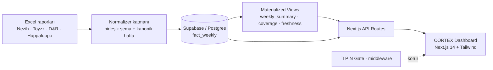

<div align="center">

# 🧠 CORTEX

### Mythos Retail Intelligence

**Çok-perakendeci haftalık satış & stok zekâsı — dağınık Excel'leri tek bir karar ekranına dönüştüren platform.**


</div>

---

## Neden var?

Her perakende kanalı raporunu **farklı formatta, farklı günde ve ayrı bir Excel** olarak gönderiyor. Bunları elle birleştirmek hem yavaş hem hataya açık. CORTEX bu akışı otomatikleştiriyor: her kanalın dosyasını tek bir birleşik şemaya indiriyor, haftaları ortak bir takvime hizalıyor ve sonucu ciro odaklı, karşılaştırılabilir bir panoya dönüştürüyor.

> Tek soruya hızlı cevap: **"Bu hafta ne sattık, nerede büyüdük, nerede stok riski var?"**

Entegre kanallar: **Nezih · Huppaluppo · Toyzz · D&R** (Armağan entegrasyonu hazır, veri bekliyor). Ölçek: ~356K satır, 50+ haftalık Excel, tek birleşik tablo.

---

## ✨ Özellikler

| | |
|---|---|
| 📊 **Yönetici Özeti** | Ağ geneli haftalık ciro (TL) ve adet, haftanın öne çıkan/zayıf kanalı, çift WoW (adet + ciro). |
| 🏆 **Sıralamalar** | En çok satan ürünler ve büyüme liderleri — ciro veya adet bazında. |
| ⏳ **Stok Süresi (Coverage)** | SKU bazında "kaç haftalık stok kaldı?" — kritik (`<8 hf`) ve fazla (`>30 hf`) stok otomatik işaretlenir. |
| 🚨 **Intelligence Sinyalleri** | Momentum, z-score anomali, stockout riski ve gelecek-hafta tahmini. |
| 🔀 **Karşılaştır & Mağazalar** | Kanallar ve mağazalar arası kıyas; ürün/SKU kırılımına kadar iniş. |
| 📈 **Trend & Isı Haritası** | Haftalık seyir (TL varsayılan) ve kanal × hafta yoğunluk görünümü. |
| 📥 **Excel / CSV Export** | Her görünüm tek tıkla çok-sayfalı rapora dönüşür. |
| 🔐 **PIN'li Giriş** | Tüm site `middleware` ile korunur; PIN sunucuda doğrulanır. |

**Tasarım ilkesi:** Tüm büyüme/WoW göstergeleri **varsayılan ciro (TL) bazlıdır**, adet seçilebilir. Böylece "adet arttı ama ciro düştü" yanılgısının önüne geçilir.

---

## 🏗️ Mimari



**Akışın özü:** Ham Excel → normalize → tek gerçek tablo (`fact_weekly`) → ağır toplamlar **materialized view**'larda önceden hesaplanır (free-tier sorgu zaman aşımını aşmamak için) → API → pano. Her veri yazımından sonra `refresh_summaries()` görünümleri tazeler.

---

## 🧩 Veri işleme (normalizer'lar)

Her kanalın formatı farklı; hepsi ortak bir `UnifiedRow` şemasına indirgenir:

- **Toyzz / D&R** — Asepto formatı (`asepto.ts`, 3 varyant). Ciro = PSF × adet. Etiketsiz "Genel Toplam" satırları elenir (çift sayımı önler).
- **Nezih** — barkod formatı (`nezih.ts`); kendi TL'si yok → barkod bazında diğer kanalların fiyatından **medyan birim fiyat** türetilerek ciro tamamlanır (enrichment).
- **Huppaluppo** — "Stok Raporu" (`huppaluppo.ts`); başlık offsetli, hafta dosyanın içindeki tarih aralığından okunur, satış tutarı (TL) hazır gelir.

**Kanonik hafta:** Kanallar aynı haftayı farklı gün/etiketle gönderebiliyor. Tüm `week_start` değerleri ISO Pazartesi'sine hizalanır; böylece "27 Mayıs" ve "28 Mayıs" raporları aynı haftada toplanır.

**Ürün zekâsı:** Ürün adından otomatik marka / takım / tip çıkarımı; sıralamalardaki kategori kırılımı bunu kullanır.

---

## ⚙️ Metrik mantığı

- **Ciro (WoW):** Bu hafta vs. tam 7 gün öncesi. **Strict** — bir kanalın o haftaya ait verisi yoksa hesaba katılmaz (geçen haftanın verisi "bu hafta" gibi görünmez).
- **Stok süresi:** `son stok ÷ ortalama haftalık satış`. `< 8 hafta` → kritik (sipariş); `> 30 hafta` veya ölü stok → fazla (kampanya).
- **Sell-through, momentum, anomali, forecast:** `src/lib/compute.ts` içinde saf, test edilebilir fonksiyonlar.

---

## 🔐 Güvenlik

- **PIN kapısı:** `middleware.ts` tüm rotaları korur; 6 haneli PIN **sunucuda** (`/api/auth`) doğrulanır, tarayıcıya inmez. Başarılı girişte `httpOnly` oturum çerezi (30 gün). Yanlış denemede gecikme.
- **Sır yönetimi:** Hiçbir anahtar/PIN repoda tutulmaz — hepsi ortam değişkeninden gelir. Env yoksa giriş **kapalı** (fail-closed).
- **Veritabanı:** Yazma yalnızca sunucu tarafında service-role ile; istemciye yalnızca anon anahtar + RLS.
- **Şirket verisi:** Gerçek satış Excel'leri (`seed/`) `.gitignore` ile dışarıda; repoda yalnızca kod bulunur.

---

## 🛠️ Teknoloji

| Katman | Araç |
|---|---|
| Framework | Next.js 14 (App Router) · React 18 · TypeScript |
| Veri | Supabase (Postgres + PostgREST + RLS + Materialized Views) |
| UI | Tailwind CSS · Framer Motion · Recharts |
| Excel | SheetJS (xlsx) |
| Dağıtım | Vercel |

---

## 🚀 Kurulum

```bash
# 1) Bağımlılıklar
npm install

# 2) Ortam değişkenleri
cp .env.example .env.local
#   → Supabase URL/anahtarları, UPLOAD_TOKEN, SITE_PIN ve CORTEX_SESSION'ı doldur.
#   CORTEX_SESSION üret:
node -e "console.log(require('crypto').randomBytes(24).toString('hex'))"

# 3) Veritabanı şeması (Supabase SQL editöründe bağımlılık sırasıyla çalıştır)
#   supabase/schema.sql            # fact_weekly + import_log + sku_prices + temel matview'lar
#   supabase/consignment.sql       # consignment_lines (sat-öde) tablosu
#   supabase/product-alias.sql     # product_alias (barkod eşleme) tablosu
#   supabase/coverage.sql          # sku_coverage matview
#   supabase/product-coverage.sql  # product_coverage matview (product_alias'a bağımlı)
#   supabase/refresh-fix.sql       # refresh_summaries() + refresh_product_coverage() (en son)

# 4) Geliştirme sunucusu
npm run dev    # http://localhost:3000  (önce /giris ekranı gelir)
```

### Veri yükleme

- **Tekil / haftalık:** `/upload` sayfası (UPLOAD_TOKEN ister).
- **Toplu / geçmiş:** Excel dosyalarını `seed/<kanal>/` altına koy (`toyzz`, `dr`, `nezih`, `huppaluppo`) ve:
  ```bash
  npm run seed
  ```

### Test

```bash
npm test     # 103 test — normalizer'lar (gerçek dosyalar), compute katmanı, edge case'ler
```

---

## 📦 Proje yapısı

```
src/
├─ app/                 # sayfalar + API route'ları (dashboard, rankings, coverage, export, auth…)
├─ components/          # RetailerCard, TrendChart, Heatmap, KpiHero…
├─ lib/
│  ├─ normalizers/      # kanal-bazlı Excel → UnifiedRow + kanonik hafta
│  └─ compute.ts        # özet, sıralama, coverage, sinyal hesapları
└─ middleware.ts        # PIN giriş kapısı
scripts/                # seed.ts (toplu yükleme) · test.ts
supabase/               # şema + materialized view migration'ları
```

---

## 🗺️ Yol haritası

- [ ] **Net kazanç hesabı** — Mevcut ciro PSF (brüt, KDV dahil) üzerinden. Sonraki sürümde KDV ayrıştırma + kanal sözleşmelerine göre net kazanç: *"ne kadar sattık"* → *"ne kadar kazandık"*.
- [ ] Armağan kanalı entegrasyonu.
- [ ] Otomatik haftalık veri akışı.
- [ ] Cross-retailer SKU eşleştirme (aynı ürünün kanallar arası karşılaştırması).

---

## 📸 Ekran görüntüleri

<!-- Ekran görüntülerini buraya ekleyebilirsin: docs/ klasörü açıp  gibi. -->
_Yakında._

---

<div align="center">

**© Unholy Labs / Mert Dönmezler**

</div>
